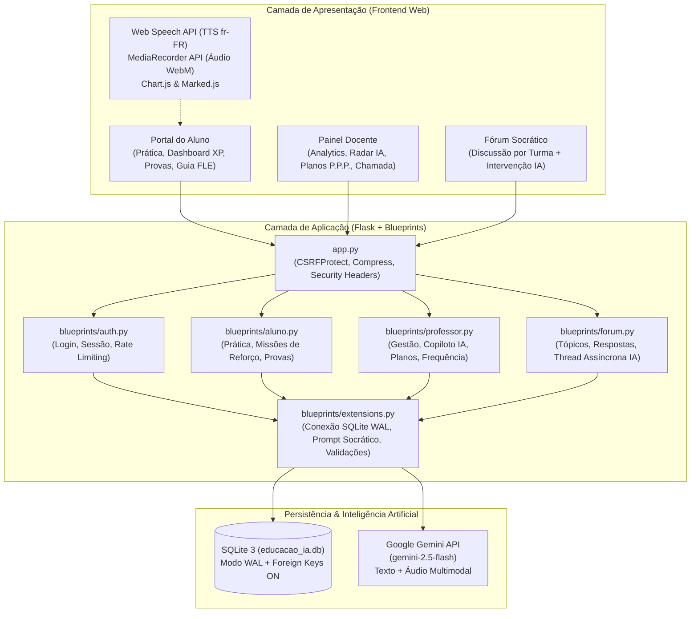
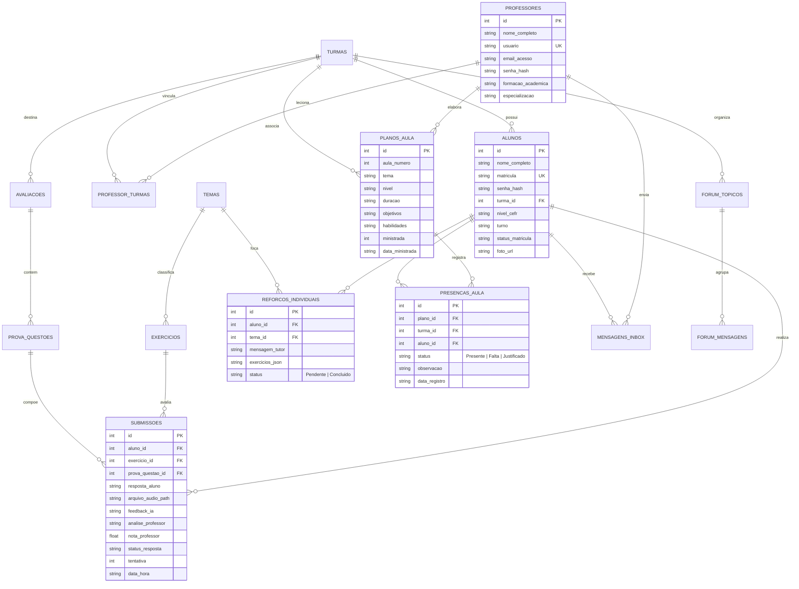

# 🇫🇷 Assistente Fran — Plataforma Inteligente de Ensino de Francês (FLE)

> **Sistema de Gestão de Aprendizagem (LMS) e Tutoria Socrática Assistida por Inteligência Artificial Generativa para o Ensino de Francês Língua Estrangeira (*Français Langue Étrangère — FLE*), alinhado ao Quadro Europeu Comum de Referência para as Línguas (QECR / CEFR: A1 a C2).**

---

## 📌 1. Visão Geral e Justificativa Pedagógica

O **Assistente Fran** foi projetado para apoiar professores e estudantes de língua francesa em sala de aula e no estudo autônomo. Diferente de corretores automáticos convencionais que apenas entregam a resposta pronta, a plataforma aplica a **Abordagem Socrática e Formativa**:

1. **Andaime Pedagógico (*Scaffolding*):** Na 1ª tentativa incorreta, a IA identifica o desvio gramatical (ex.: escolha entre os auxiliares *Être* e *Avoir* no *Passé Composé*, concordância do particípio passado, uso dos pronomes *Y* e *EN* ou *Articles Partitifs*) e oferece uma **pista reflexiva** para que o próprio estudante construa a correção na 2ª tentativa.
2. **Engenharia Didática P.P.P. (*Présentation, Pratique, Production*):** Catálogo completo de Planos de Aula estruturados por ciclo (`A1–A2`, `B1–B2`, `C1–C2`), integrando cronômetro de sala de aula, **Diário de Classe (Controle de Frequência)** e geração automática de provas multimodais alinhadas à aula.
3. **Avaliação Multimodal:** Suporte integrado a questões de conjugação, tradução, ditado com síntese de voz nativa (`fr-FR`) e leitura oral com gravação de áudio (`MediaRecorder API`) analisada pelo modelo multimodal **Google Gemini**.

---

## 🏗️ 2. Arquitetura do Sistema

A aplicação segue uma arquitetura modular em **Flask Blueprints**, separando claramente as responsabilidades de autenticação, portal do estudante, painel docente, fórum socrático e serviços compartilhados de IA e persistência.



---

## 🗄️ 3. Modelo Entidade-Relacionamento (DER)

O banco de dados relacional `educacao_ia.db` possui integridade referencial ativa (`PRAGMA foreign_keys = ON`) e índices otimizados para consultas analíticas:



---

## ✅ 4. Requisitos do Projeto Acadêmico

### 4.1. Requisitos Funcionais (RF)
| Código | Requisito Funcional | Módulo / Arquivo |
| :--- | :--- | :--- |
| **RF01** | Autenticação unificada para Professores (por usuário) e Alunos (por matrícula) com controle de sessão. | `blueprints/auth.py` |
| **RF02** | Prática assistida por IA em 6 formatos (*Lacunas, V/F, Múltipla Escolha, Ditado, Expressão Oral, Produção Escrita*). | `blueprints/aluno.py` |
| **RF03** | Feedback socrático progressivo (1ª tentativa com dica reflexiva; 2ª tentativa com resolução comentada). | `blueprints/extensions.py` |
| **RF04** | Painel de gamificação do estudante com cálculo de XP, evolução CEFR, gráfico semanal, frequência e 6 insígnias (*Badges*). | `templates/aluno_dashboard.html` |
| **RF05** | Provas multimodais com ditado por voz (`fr-FR`), gravação de leitura oral e avaliação fonética pelo Gemini. | `templates/aluno_prova.html` |
| **RF06** | Guia Gramatical FLE interativo com conjugador verbal completo em 5 tempos e áudio nativo. | `guia_fle_data.py` |
| **RF07** | Dashboard analítico docente com KPIs, gráficos por tema, filtro dinâmico por turma/nível e exportação CSV/Boletim. | `blueprints/professor.py` |
| **RF08** | Radar de Intervenção Pedagógica para envio e conclusão interativa de Missões de Reforço individualizadas. | `blueprints/professor.py` & `aluno.py` |
| **RF09** | Gestão de Planos de Aula no modelo P.P.P. com gerador IA, cronômetro de sala e geração de provas vinculadas. | `templates/professor_planos_aula.html` |
| **RF10** | **Diário de Classe e Chamada** vinculado a cada Plano de Aula para registro de presença, falta ou justificativa. | `blueprints/professor.py` |
| **RF11** | Fórum de dúvidas por turma com intervenção assíncrona em *background* do tutor socrático IA. | `blueprints/forum.py` |
| **RF12** | Sistema interno de mensagens/recados do professor para alunos individuais ou turmas inteiras. | `blueprints/professor.py` |

### 4.2. Requisitos Não-Funcionais (RNF) e Segurança
- **RNF01 (Proteção CSRF):** Todos os formulários e chamadas `fetch` (`POST`/`DELETE`) são protegidos por tokens `Flask-WTF CSRFProtect`.
- **RNF02 (Prevenção de Força Bruta):** Rate limiting em memória por IP no endpoint `/login`.
- **RNF03 (Validação Binária de Uploads):** Verificação de *magic bytes* (assinatura binária PNG/JPEG/GIF/WEBP) e limite de payload (`MAX_CONTENT_LENGTH = 16 MB`).
- **RNF04 (Prevenção contra XSS e IDOR):** Sanitização de HTML gerado por Markdown no frontend e verificação estrita de `turma_id` e propriedade de avaliações no backend.
- **RNF05 (Concorrência SQLite):** Conexões gerenciadas no ciclo de vida da requisição (`flask.g` + `teardown_appcontext`) com `PRAGMA journal_mode = WAL` e `timeout = 15.0s`.
- **RNF06 (Resiliência Offline/Fallback):** Caso a chave `GEMINI_API_KEY` não esteja configurada ou exceda a cota, o sistema opera de forma transparente com o banco pedagógico local estruturado (`BANCO_PEDAGOGICO_TEMAS`).

---

## 📂 5. Estrutura de Diretórios

```text
Assistente_Fran/
├── app.py                      # Ponto de entrada Flask, configurações de segurança e filtros Jinja
├── database_setup.py           # Criação do schema relacional SQLite e população inicial (Seeds)
├── seed_planos_aula.py         # Catálogo base de 24 Planos de Aula FLE (A1 a C2) no modelo P.P.P.
├── seed_populacao_graficos.py  # Dados realistas para demonstração de gráficos e métricas
├── guia_fle_data.py            # Base estruturada do Guia Gramatical FLE e Conjugador Verbal
├── requirements.txt            # Dependências Python do projeto
├── deploy_gcp.sh               # Script de provisionamento automatizado (Nginx + Gunicorn + Systemd)
├── blueprints/
│   ├── extensions.py           # Conexão DB, migrações automáticas, motor Gemini e banco pedagógico
│   ├── auth.py                 # Autenticação, logout e proteção contra força bruta
│   ├── main.py                 # Landing page pública e mural de destaques
│   ├── aluno.py                # Rotas do estudante (prática, dashboard, provas, reforço, perfil)
│   ├── professor.py            # Rotas do docente (analytics, planos, chamada, avaliações, alunos)
│   └── forum.py                # Fórum acadêmico com thread de resposta da IA
├── templates/                  # Templates Jinja2 responsivos (Modo Claro/Escuro e Impressão A4)
└── static/
    ├── css/style.css           # Design System Editorial FLE
    └── js/                     # Lógica cliente (main.js, dashboard.js, TTS fr-FR, gráficos)
```

---

## 🚀 6. Como Executar o Projeto Localmente

### Pré-requisitos
- **Python 3.10+** instalado
- Chave de API do Google Gemini (opcional — o sistema possui modo de demonstração pedagógica integrado caso não seja informada)

### Passo a Passo

1. **Clone o repositório e acesse a pasta:**
   ```bash
   git clone <url-do-repositorio>
   cd Assistente_Fran
   ```

2. **Crie e ative o ambiente virtual:**
   ```powershell
   # Windows (PowerShell)
   python -m venv venv
   .\venv\Scripts\Activate.ps1

   # Linux / macOS
   python3 -m venv venv
   source venv/bin/activate
   ```

3. **Instale as dependências:**
   ```bash
   pip install -r requirements.txt
   ```

4. **Configure as variáveis de ambiente:**
   Copie o arquivo `.env.example` para `.env` e adicione sua chave do Google Gemini:
   ```ini
   GEMINI_API_KEY=sua_chave_aqui
   FLASK_SECRET_KEY=chave_secreta_segura
   FLASK_DEBUG=True
   ```

5. **(Opcional) Inicialize/recrie o banco de dados com dados de demonstração:**
   ```bash
   python database_setup.py
   ```

6. **Inicie o servidor:**
   ```bash
   python app.py
   ```
   Acesse no navegador: **http://127.0.0.1:5000**

---

## 🔑 7. Credenciais de Acesso para Demonstração (Banca / Testes)

| Perfil | Login (Usuário / Matrícula) | Senha | Funcionalidades Principais para Testar |
| :--- | :---: | :---: | :--- |
| **Professor (Admin)** | `admin` | `admin` | Dashboard Analítico, Planos de Aula P.P.P., **Diário de Classe (Chamada)**, Radar de Reforço e Criador de Provas IA |
| **Aluno 1 (Nível B1)** | `202601` | `123456` | Prática Assistida (`/pratica`), Meu Desempenho, **Missão de Reforço**, Provas Multimodais e Guia FLE |
| **Aluno 2 (Nível A1)** | `202602` | `123456` | Evolução de nível inicial, Medalhas FLE, Fórum Socrático e Perfil |

---

## 🧪 8. Execução dos Testes Automatizados

O projeto conta com suítes de testes automatizados (`unittest`) que validam as rotas do aluno, geração pedagógica de questões e regras de segurança:

```powershell
.\venv\Scripts\python.exe scratch\test_questoes_gerador.py
.\venv\Scripts\python.exe scratch\test_aluno_portal.py
```
